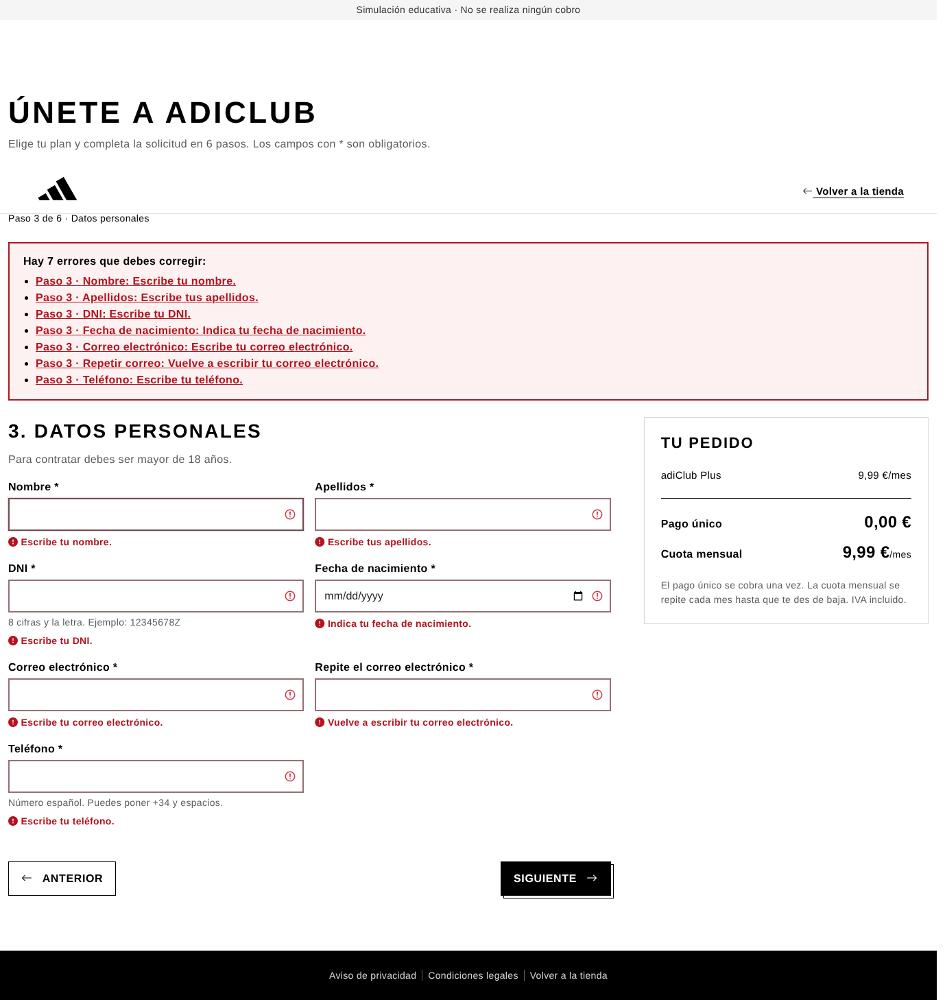
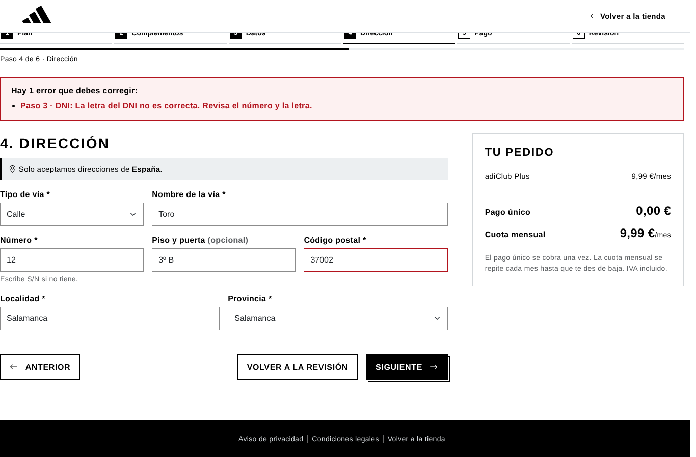
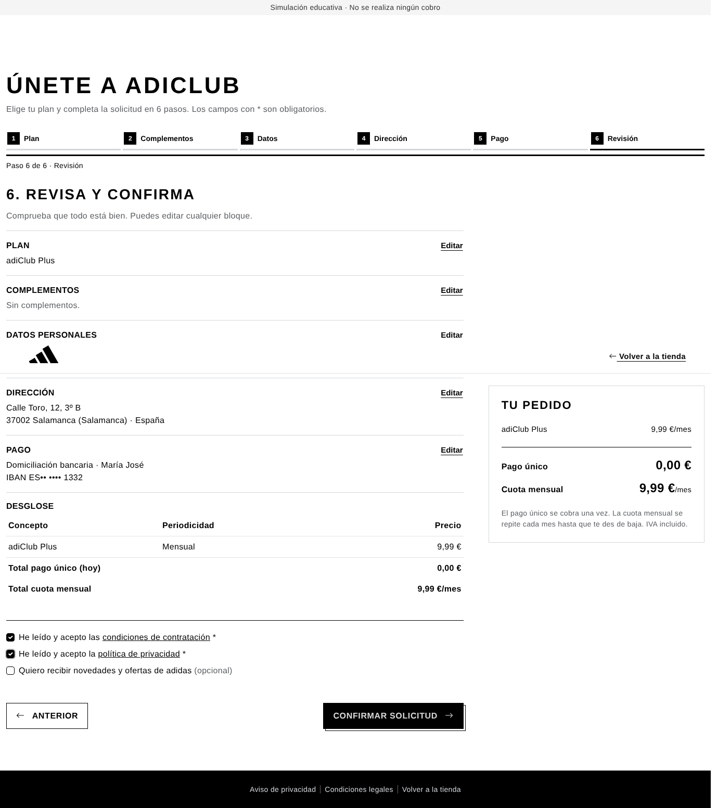

# Tabla de pruebas · Formulario de contratación adiClub

Todas las pruebas usan **datos ficticios**. Se han pasado dos veces:

1. Con el formulario normal.
2. Con una **copia de prueba sin `required`, `pattern`, `min`, `max` ni `maxlength`** (y `type="email"`/`"tel"` cambiados a `text`). Los resultados fueron los mismos, así que quien valida es JavaScript y no el navegador.

Fecha de las pruebas: 16/11/2026 (por eso «cumple 18 hoy» es 16/11/2008).

| # | Prueba | Datos ficticios | Resultado esperado | Resultado obtenido | OK/KO |
|---|---|---|---|---|---|
| 1 | Vacíos y espacios | Siguiente sin plan · Nombre `"    "` | No avanza y enfoca el primer campo obligatorio incorrecto | Sin plan: foco en «adiClub Básico». Con espacios: foco en *Nombre* y «Escribe tu nombre.» | OK |
| 2 | Correo y teléfono | `maria.correo.es` · confirmación `otra@correo.es` · teléfono `512345678` | Detecta formato inválido y correos que no coinciden | «El correo no tiene un formato válido», «Los dos correos no coinciden», «El teléfono debe tener 9 cifras y empezar por 6, 7, 8 o 9». `+34 612 34 56 78` y `MARIA.prueba@correo.es ` se aceptan | OK |
| 3 | DNI | `12345678A` (la correcta es Z) | Rechaza una letra de control incorrecta | «La letra del DNI no es correcta» y foco en DNI. `12345678Z` se acepta | OK |
| 4 | Edad | `2008-11-16` · `2008-11-17` · `2027-01-01` | Acepta el día que cumple 18, rechaza el anterior y fechas futuras | Acepta 16/11/2008. Rechaza 17/11/2008 («al menos 18 años») y 01/01/2027 («no puede estar en el futuro») | OK |
| 5 | Dirección | CP `28013` con provincia Salamanca | Rechaza un CP incompatible con la provincia | «Este código postal no es de Salamanca. Los de esa provincia empiezan por 37.» Al cambiar a Madrid, el error desaparece | OK |
| 6 | Productos | Sin plan · Plus + Envío exprés y después cambio a Pro | Bloquea la ausencia de producto y un complemento incompatible | Sin plan no avanza. Al cambiar a Pro sale un aviso en el paso 1 y el paso 2 no deja avanzar: «El plan Pro ya incluye el envío exprés ilimitado» | OK |
| 7 | IBAN | `ES91 2100 0418 4502 0005 1333` | Rechaza un IBAN con formato correcto y control incorrecto | «Los dígitos de control no cuadran». `ES91 2100 0418 4502 0005 1332` se acepta | OK |
| 8 | Tarjeta | `4111 1111 1111 1112` · `01/24` · CVV `12` | Detecta Luhn incorrecto, caducidad pasada y CVV inválido | «Número de tarjeta no válido», «La tarjeta está caducada», «El CVV son las 3 cifras…» | OK |
| 9 | Cambio de pago | Tarjeta con errores → cambio a domiciliación con IBAN válido → vuelta a tarjeta vacía | Ignora los campos inactivos y exige los del nuevo método | Con domiciliación pasa a revisión sin errores de tarjeta, y la tarjeta no sale en el resumen. Al volver a tarjeta, exige el número | OK |
| 10 | Casillas | Confirmar sin marcar · solo condiciones · las dos sin publicidad | Exige las dos obligatorias y permite rechazar la publicidad | Sin marcar: dos errores. Solo condiciones: sigue bloqueado. Las dos obligatorias con la publicidad desmarcada: se envía | OK |
| 11 | KO y corrección | En revisión, DNI `12345678A` y CP `28013` | Con varios errores, abre el primer paso, hace ancla, enfoca y conserva datos | Resumen con 2 enlaces. Abre el paso 3 con el foco en DNI. El enlace 2 lleva al paso 4 y enfoca el CP. Nombre y localidad se conservan. Al corregir, el resumen baja a 1 | OK |
| 12 | Recorrido OK | Recorrido completo válido | Vuelve al home, muestra el modal una vez y no lo repite al recargar | Modal «Solicitud registrada correctamente» en `index.html`. Se cierra. No aparece al recargar ni al entrar directamente | OK |

Pruebas extra:

| Prueba | Resultado | OK/KO |
|---|---|---|
| Solo teclado | Con las flechas se elige el plan, con Tab se llega a Siguiente y Enter avanza. Los botones de pasos, los «Editar» y los modales se pueden usar con el teclado | OK |
| Intro dentro de un campo | En los pasos 1 a 5 hace lo mismo que «Siguiente»: valida solo el paso actual. Antes validaba los 6 pasos y sacaba errores de pasos sin visitar (corregido en `confirmar()`) | OK |
| Móvil (390 px) | Sin scroll horizontal. Los pasos se ven solo con el número y el resumen va debajo | OK |
| Escritorio (1366 px) | Formulario a la izquierda y resumen fijo a la derecha | OK |

## Demostración de que valida JavaScript

El formulario lleva `novalidate`. Además, `contratacion-prueba-sin-html.html` es la **copia de prueba**: el mismo formulario sin los 23 `required`, sin los 4 `maxlength` y con los `type="email"` y `type="tel"` cambiados a `text`. Usa los mismos archivos de `js/`.

Prueba hecha en la copia el 16/11/2026 (paso 3, DNI `12345678A`, resto de datos válidos, botón *Siguiente*):

| Qué se comprueba | Resultado |
|---|---|
| Atributos HTML de validación en la página | 0 |
| Función ejecutada | `validarDni("12345678A")` en `js/validaciones.js` |
| Valor que devuelve | `"La letra del DNI no es correcta. Revisa el número y la letra."` |
| Mensaje en la interfaz | El mismo texto bajo el campo, `aria-invalid="true"` en el DNI y una línea en el resumen: «Paso 3 · DNI: La letra del DNI no es correcta…» |
| Navegación | No avanza: sigue en el paso 3 con el foco en el DNI |

Para verlo con punto de interrupción: abre la copia, F12 → *Sources* → `js/validaciones.js`, punto de interrupción en la primera línea de `validarDni` y repite la prueba.

## Cómo repetir las pruebas

- **Reglas sueltas** (50 comprobaciones): `node tests/validaciones.test.js`
- **Recorrido en navegador** (necesita Python y Playwright):
  `python3 tests/recorrido_e2e.py . <carpeta_con_bootstrap> capturas/practica2` y, para la copia sin validación HTML, se añade `sin-html` al final.
- **A mano**: con la copia de prueba y un punto de interrupción, como se explica arriba.

## Capturas

| Errores en el paso 3 | Resumen de errores con enlaces | Revisión |
|---|---|---|
|  |  |  |
