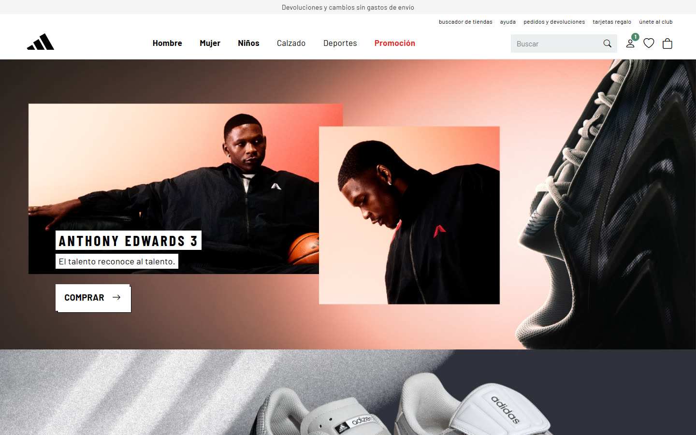
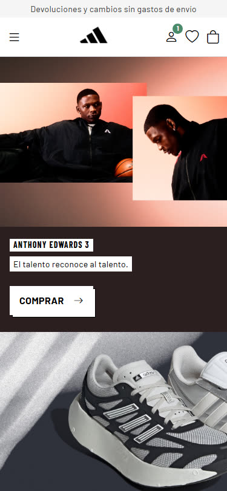
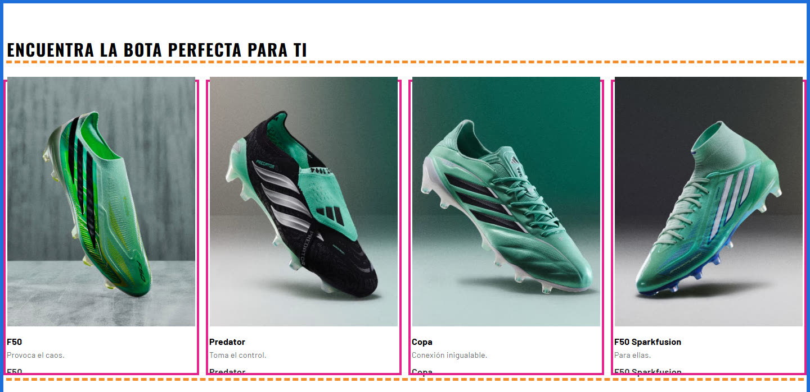

[README.md](https://github.com/user-attachments/files/33653564/README.md)
# Recreación de adidas.es con Bootstrap

Recreación de la portada de [adidas.es](https://www.adidas.es) hecha con **HTML, CSS y Bootstrap 5**, sin nada de JavaScript.
La página se adapta a móvil, tablet y ordenador, y las partes interactivas (menú lateral, pestañas y megamenú) funcionan solo con CSS.

> Proyecto educativo de maquetación web. No es una página oficial: la marca, las imágenes y las fuentes pertenecen a adidas.

| Ordenador | Móvil |
|---|---|
|  |  |

## Cómo verla

1. Descarga el repositorio (**Code → Download ZIP**) o clónalo:
   ```bash
   git clone https://github.com/Samuelypsv/boostrap-adidas.git
   ```
2. Abre `index.html` en el navegador.

Hace falta conexión a internet, porque Bootstrap, Bootstrap Icons y las fuentes de Google se cargan desde un CDN.

## Tecnologías

- HTML5
- CSS3, con estilos propios en `styles.css`
- [Bootstrap 5.3](https://getbootstrap.com/) (solo el CSS, sin `bootstrap.bundle.js`)
- [Bootstrap Icons](https://icons.getbootstrap.com/)

## Archivos

```
├── index.html     → estructura de la página
├── styles.css     → estilos propios y media queries
├── images/        → fotos de productos y banners
├── fonts/         → fuentes de adidas
└── capturas/      → imágenes de este README
```

## Partes de la página

| Parte | Lo más interesante |
|---|---|
| Cabecera | Fija arriba con `sticky-top`. El menú completo solo en ordenador (`d-none d-xl-flex`); en móvil, menú lateral `offcanvas` |
| Banners | Foto a todo lo ancho con el texto encima, ordenado con `d-flex flex-column gap-2` |
| Encuentra tu bota | Rejilla con `row g-4` y `col-6 col-md-3`: 2 por fila en móvil, 4 en ordenador |
| Tarjetas destacadas | Carrusel sin JS: `row flex-nowrap overflow-auto` |
| Novedades / Próximamente | Pestañas `nav-pills` que cambian solo con CSS |
| Descubre y categorías | `col-6 col-md-4` y etiquetas con `position-absolute bottom-0 start-0 m-3` |
| Club y pie | El pie pasa de 2 a 4 y a 7 columnas con `col-6 col-md-3 col-xl` |

### La rejilla de Bootstrap

En azul el `container`, en naranja la `row` y en rosa cada columna `col-*`:



## Responsive

Se usan los mismos puntos de ruptura que Bootstrap, tanto en las clases como en las media queries propias de `styles.css`:

| Pantalla | Ancho | Qué cambia |
|---|---|---|
| Móvil | 320 – 767 px | Menú lateral; en los banners la foto va arriba y el texto debajo; 2 columnas |
| Tablet | 768 – 1199 px | Todavía menú lateral; 3 o 4 columnas |
| Ordenador | 1200 – 1920 px | Menú completo con buscador y megamenú |

## Sin JavaScript

Las partes que normalmente necesitan JavaScript están resueltas con CSS:

- **Menú lateral del móvil:** un `checkbox` oculto. El icono ☰ es un `<label>` que lo marca y el CSS muestra el menú con `:checked`.
  ```css
  .menu-toggle:checked ~ .menu-panel { transform: none; visibility: visible; }
  ```
- **Pestañas Novedades / Próximamente:** dos `radio` ocultos con el mismo `name`. Cada pestaña es un `<label>` y el CSS enseña el panel del que está marcado.
- **Megamenú de Promoción:** aparece con `:hover`.
- **Carruseles:** filas que se deslizan de lado con `overflow-auto` y `scroll-snap`.

## Autor

Samuel · [@Samuelypsv](https://github.com/Samuelypsv)
