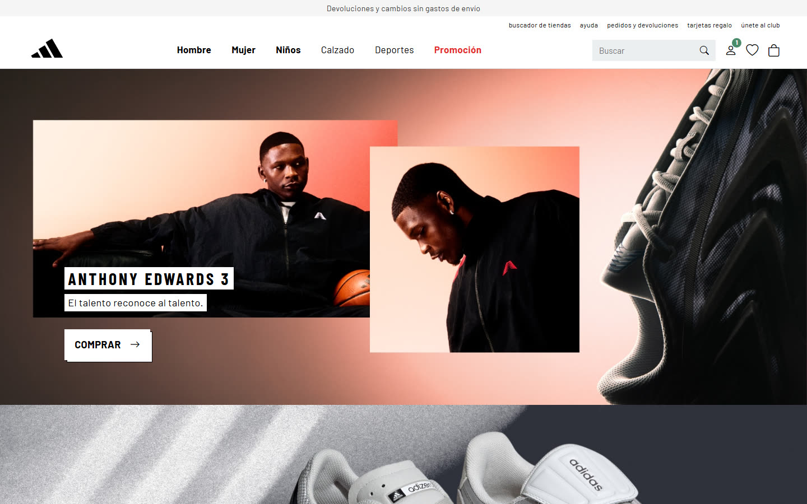
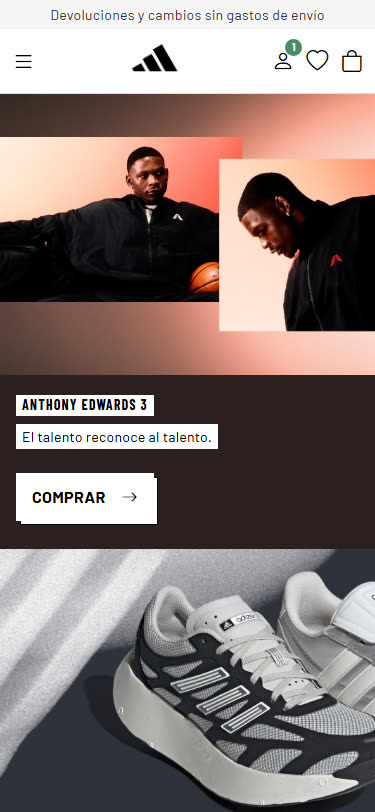
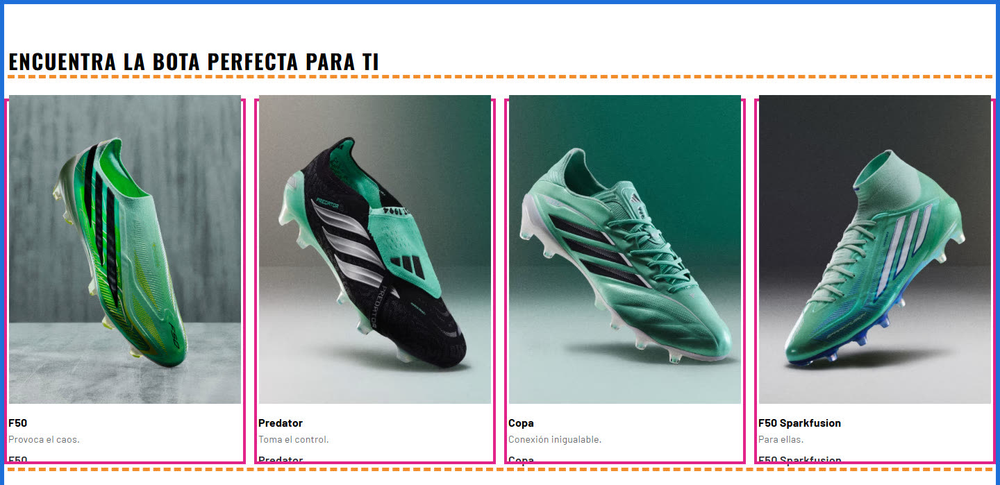
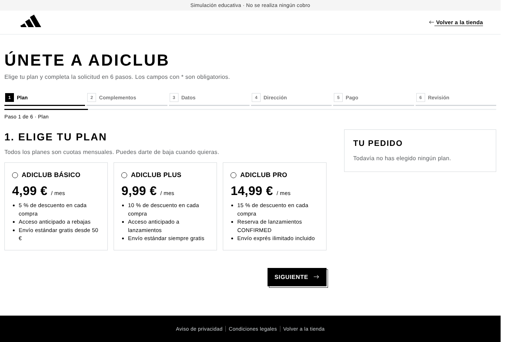
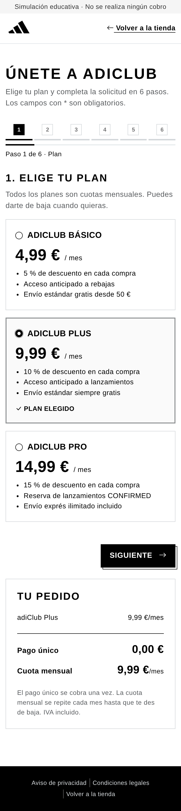

# Recreación de adidas.es con Bootstrap

Recreación de la portada de [adidas.es](https://www.adidas.es) hecha con **HTML, CSS y Bootstrap 5**, sin nada de JavaScript.
La página se adapta a móvil, tablet y ordenador, y las partes interactivas (menú lateral, pestañas y megamenú) funcionan solo con CSS.

> Proyecto educativo de maquetación web. No es una página oficial: la marca, las imágenes y las fuentes pertenecen a adidas.

| Ordenador | Móvil |
|---|---|
|  |  |

## Cómo verla

1. Descarga el repositorio (**Code → Download ZIP**) o clónalo:
   ```bash
   git clone https://github.com/Samuelypsv/boostrap-adidas.git
   ```
2. Abre `index.html` en el navegador.

Hace falta conexión a internet, porque Bootstrap, Bootstrap Icons y las fuentes de Google se cargan desde un CDN.

## Tecnologías

- HTML5
- CSS3, con estilos propios en `styles.css`
- [Bootstrap 5.3](https://getbootstrap.com/) (solo el CSS, sin `bootstrap.bundle.js`)
- [Bootstrap Icons](https://icons.getbootstrap.com/)

## Archivos

```
├── index.html     → estructura de la página
├── styles.css     → estilos propios y media queries
├── images/        → fotos de productos y banners
├── fonts/         → fuentes de adidas
└── capturas/      → imágenes de este README
```

## Partes de la página

| Parte | Lo más interesante |
|---|---|
| Cabecera | Fija arriba con `sticky-top`. El menú completo solo en ordenador (`d-none d-xl-flex`); en móvil, menú lateral `offcanvas` |
| Banners | Foto a todo lo ancho con el texto encima, ordenado con `d-flex flex-column gap-2` |
| Encuentra tu bota | Rejilla con `row g-4` y `col-6 col-md-3`: 2 por fila en móvil, 4 en ordenador |
| Tarjetas destacadas | Carrusel sin JS: `row flex-nowrap overflow-auto` |
| Novedades / Próximamente | Pestañas `nav-pills` que cambian solo con CSS |
| Descubre y categorías | `col-6 col-md-4` y etiquetas con `position-absolute bottom-0 start-0 m-3` |
| Club y pie | El pie pasa de 2 a 4 y a 7 columnas con `col-6 col-md-3 col-xl` |

### La rejilla de Bootstrap

En azul el `container`, en naranja la `row` y en rosa cada columna `col-*`:



## Responsive

Se usan los mismos puntos de ruptura que Bootstrap, tanto en las clases como en las media queries propias de `styles.css`:

| Pantalla | Ancho | Qué cambia |
|---|---|---|
| Móvil | 320 – 767 px | Menú lateral; en los banners la foto va arriba y el texto debajo; 2 columnas |
| Tablet | 768 – 1199 px | Todavía menú lateral; 3 o 4 columnas |
| Ordenador | 1200 – 1920 px | Menú completo con buscador y megamenú |

## Sin JavaScript

Las partes que normalmente necesitan JavaScript están resueltas con CSS:

- **Menú lateral del móvil:** un `checkbox` oculto. El icono ☰ es un `<label>` que lo marca y el CSS muestra el menú con `:checked`.
  ```css
  .menu-toggle:checked ~ .menu-panel { transform: none; visibility: visible; }
  ```
- **Pestañas Novedades / Próximamente:** dos `radio` ocultos con el mismo `name`. Cada pestaña es un `<label>` y el CSS enseña el panel del que está marcado.
- **Megamenú de Promoción:** aparece con `:hover`.
- **Carruseles:** filas que se deslizan de lado con `overflow-auto` y `scroll-snap`.

---

# Práctica 2 · Formulario de contratación adiClub

Desde la home, el botón **«Únete a adiClub»** (en la franja verde del club) y el enlace **«únete al club»** de arriba llevan a `contratacion.html`. Ahí se contrata una suscripción **adiClub** en 6 pasos. Es una **simulación**: no hay servidor ni se cobra nada.

| Ordenador | Móvil |
|---|---|
|  |  |

## Cómo ejecutarlo

1. Abre `index.html` en el navegador (o usa *Live Server* en VS Code).
2. Pulsa **«Únete a adiClub»** y completa los pasos.
3. Al confirmar, vuelves a la home y se abre el modal «Solicitud registrada correctamente».

Hace falta internet para Bootstrap y las fuentes. El modal se basa en `sessionStorage`, así que funciona igual abriendo el archivo directamente o con un servidor.

## Escenario

| Paso | Qué hay |
|---|---|
| 1. Plan | 3 cards: Básico 4,99 €/mes · Plus 9,99 €/mes · Pro 14,99 €/mes. Solo se elige uno (radio) |
| 2. Complementos | Kit de bienvenida 24,95 € (pago único) · Dorsal 12,00 € (pago único) · Envío exprés 2,99 €/mes. **Regla:** el envío exprés no se puede añadir al plan Pro, porque ya lo incluye |
| 3. Datos | Nombre, apellidos, DNI, fecha de nacimiento (18 años o más), correo y confirmación, teléfono |
| 4. Dirección | Solo España. El código postal tiene que coincidir con la provincia |
| 5. Pago | Domiciliación (titular + IBAN) o tarjeta simulada (titular, número, MM/AA, CVV) |
| 6. Revisión | Resumen con «Editar», desglose y casillas legales |

Los **pagos únicos** y la **cuota mensual** se suman por separado y nunca se mezclan en un único total.

## Datos ficticios para probar

| Campo | Válido | No válido |
|---|---|---|
| DNI | `12345678Z` | `12345678A` |
| Teléfono | `+34 612 34 56 78` | `512345678` |
| Fecha de nacimiento | `12/04/1995` | una fecha de hace menos de 18 años |
| Código postal | `37002` + Salamanca | `28013` + Salamanca |
| IBAN | `ES91 2100 0418 4502 0005 1332` | `ES91 2100 0418 4502 0005 1333` |
| Tarjeta | `4111 1111 1111 1111` · `12/29` · `123` | `4111 1111 1111 1112` · `01/24` · `12` |

## Archivos nuevos

```
├── contratacion.html        → los 6 pasos del formulario (con novalidate)
├── css/contratacion.css     → estilos del formulario (usa las variables de styles.css)
├── js/datos.js              → planes, complementos y provincias (precios en céntimos)
├── js/validaciones.js       → REGLAS: funciones que devuelven el mensaje de error o ""
├── js/errores.js            → PRESENTACIÓN: mensajes, aria-invalid, aria-describedby, resumen
├── js/formulario.js         → NAVEGACIÓN y estado: pasos, precios, revisión, confirmar
├── js/home.js               → abre el modal de éxito una sola vez en la home
├── tests/                   → pruebas automáticas
├── PRUEBAS.md               → tabla de las 12 pruebas
└── TABLERO.md               → exportación del tablero de Jira con la documentación por tarea
```

En `index.html` solo se han cambiado los dos enlaces al formulario y se han añadido el modal y los scripts. En `styles.css` se han añadido unas líneas al final para el modal.

## Cómo funciona (resumido)

- **Pasos:** cada paso es un `<fieldset>`. Se cambia de paso poniendo o quitando `hidden`, así que lo escrito no se borra.
- **Siguiente** valida solo el paso actual. **Anterior** no valida nada. A un paso más adelante solo se puede ir si los anteriores están bien.
- **Lista `CAMPOS`** (en `formulario.js`): cada campo dice en qué paso está y qué regla usa. Va en orden de pantalla, y por eso el primer error siempre es el de más arriba.
- **Errores:** junto a cada campo hay icono y texto, y además `aria-invalid` y `aria-describedby`. Arriba sale un resumen con enlaces que abren el paso del campo y lo enfocan.
- **Confirmar** vuelve a validar los 6 pasos y recalcula los precios. Si todo está bien, guarda una marca en `sessionStorage` y va a `index.html`. `home.js` borra la marca y abre el modal; por eso al recargar ya no sale.

## Planificación y uso de IA

Tablero en Jira (proyecto SCRUM, épica *SCRUM-6*, tareas *SCRUM-7* a *SCRUM-17*) con las columnas Pendiente, En curso, En pruebas y Hecho. Cada tarea lleva su objetivo, su criterio de aceptación, la IA usada (Claude), el prompt en formato EARS y la prueba realizada.

La exportación del tablero, con las decisiones tomadas en cada tarea y los enlaces a los commits, está en [`TABLERO.md`](TABLERO.md). La tabla de las 12 pruebas está en [`PRUEBAS.md`](PRUEBAS.md).

## Autores

Samuel · [@Samuelypsv](https://github.com/Samuelypsv) y Manuel de la Nava López
